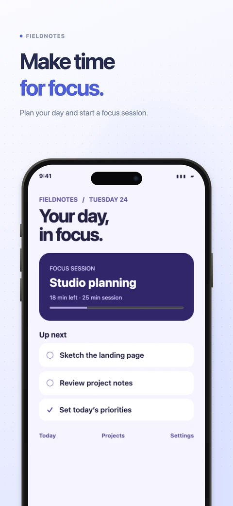

# App Store Assets Skill

[简体中文](README.zh-CN.md)

Create App Store screenshot and creative asset designs from real app screenshots. The skill produces a local HTML review first, iterates on feedback, and exports PNGs only after design approval.

## From app screenshots to store artwork

This example uses **Fieldnotes**, a fictional focus app. The images show the workflow and what the artwork can look like for one product.

| Source screenshot | Portrait artwork |
| :---: | :---: |
|  |  |

Provide your app screenshots and any brand assets. The skill plans the artwork around the features visible in your screenshots and places iPhone screenshots inside the [reusable device frame](.agents/skills/codoop-app-store-assets/assets/iphone-frame.html).

The local HTML review shows the artwork together and lets you filter, zoom, and open each canvas at full size. After you approve the design, the skill exports those canvases as PNGs.


### Landscape examples

Header and Search Results each support **one to three screenshots**. You can choose which screenshots to use, or let the skill select a set based on what each placement needs to show. These examples use one screenshot per placement to keep the focus timer prominent.

**Product Page Header**


**Search Results**


The images above are resized for this README. The skill checks current Apple requirements for the target placement before export.

## Install with the Skills CLI

Run the following in your app project:

```sh
npx skills add https://github.com/Codoop/codoop-app-pages --skill codoop-app-store-assets
```

The CLI prompts for supported agents and installs to the current project by default. Node.js 22.20 or newer is required by the current CLI. Use `-a codex` to select Codex, or `-g` for a user-wide installation. Inspect available skills first with `npx skills add https://github.com/Codoop/codoop-app-pages --list`. See the [Skills CLI](https://github.com/vercel-labs/skills) for current agent support and options.

For local development, `npx skills add /path/to/codoop-app-pages --skill codoop-app-store-assets` installs from this checkout. Public search visibility on skills.sh depends on that service's indexing and is not guaranteed by adding this command.

## Install and use

The canonical package is [codoop-app-store-assets](.agents/skills/codoop-app-store-assets/SKILL.md). Copy the **entire** `codoop-app-store-assets` directory, including the HTML templates and shared frame stylesheet in `assets/`, into the skill directory for your client. The paths below are relative to the root of the project where you want to use it, not this repository. If the destination already exists, review it before replacing it.

| Client | Project skill destination | Notes |
| --- | --- | --- |
| Codex | `.agents/skills/codoop-app-store-assets/` | Use `$codoop-app-store-assets` or ask by name. |
| Claude Code | `.claude/skills/codoop-app-store-assets/` | Ask by name or use the skill command. This repository's Claude link points to the canonical copy; copy the directory on systems without symlink support. |
| Qwen Code | `.agents/skills/codoop-app-store-assets/` or `.qwen/skills/codoop-app-store-assets/` | Use `/codoop-app-store-assets` or ask by name; check `/skills`. |
| Google Antigravity App, CLI or IDE | `.agents/skills/codoop-app-store-assets/` | Ask by name; the App and CLI also document slash invocation. |
| DeepSeek through Codex | `.agents/skills/codoop-app-store-assets/` | DeepSeek is the model provider; use the host client's installation method. Other DeepSeek clients can use a different directory. |
| WorkBuddy | See the WorkBuddy note below. | Open Platform marketplace packaging has additional metadata requirements. |

For example, after downloading this repository, copy the package to a project for Codex, Qwen Code or Antigravity (macOS/Linux):

```sh
mkdir -p /path/to/your-project/.agents/skills
cp -R /path/to/codoop-app-pages/.agents/skills/codoop-app-store-assets /path/to/your-project/.agents/skills/
```

Open the target project in your agent, refresh or restart it if needed, and check its available skills. Ask it to use `codoop-app-store-assets`, providing real screenshots, brand materials, target devices and preferences. If your client does not discover skills automatically but can read workspace files, explicitly ask it to read the copied `SKILL.md` and its accompanying template. This fallback is not automatic Skill integration.

**WorkBuddy:** its [Open Platform documentation](https://open.workbuddy.cn/en/docs/skill) specifies a `SKILL.md` package and additional required marketplace fields including display names, descriptions, version and author. The portable package in this repository has not been packaged or validated for that marketplace. Local installation and marketplace support depend on the WorkBuddy edition; follow its current import instructions rather than assuming CodeBuddy's project path applies.

These paths follow the clients' documentation, including [Qwen Code](https://github.com/QwenLM/qwen-code/blob/main/docs/users/features/skills.md), [Antigravity](https://prod-20251121t222213-dot-gweb-jetski.appspot.com/docs/skills?tab=ide), and [DeepSeek's Codex integration](https://api-docs.deepseek.com/quick_start/agent_integrations/codex/). They describe documented compatibility, not a claim that every client or version has been tested. The workflow also requires access to project files, images, current web specifications and a browser or equivalent visual inspection; report unavailable capabilities and do not claim checks were performed.

The agent should verify current Apple specifications, prepare a browser review, and wait for explicit design approval before exporting. Approval does not authorize uploading or publishing.

The template demonstrates review interactions and one illustrative visual direction, not a required layout. The agent first examines the project's brand, interface, assets and user preferences, then designs compositions around that product and each placement. It can replace the example's canvas markup, layouts, palette, typography and device treatments while retaining the review capabilities. Its copy and dimensions are placeholders; Apple placement eligibility and device cropping must be verified for the specific app.

## License

This project is licensed under the [MIT License](LICENSE).
