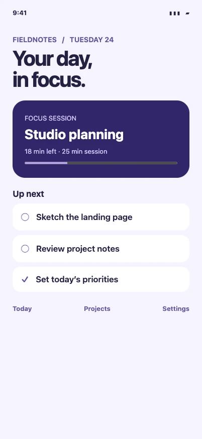
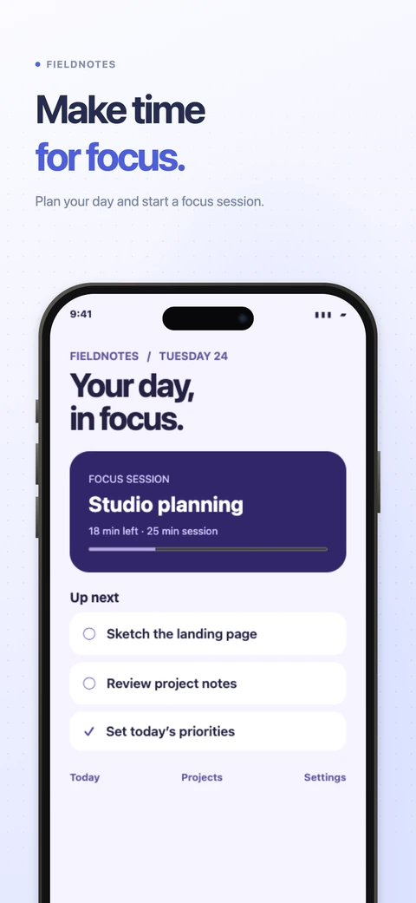
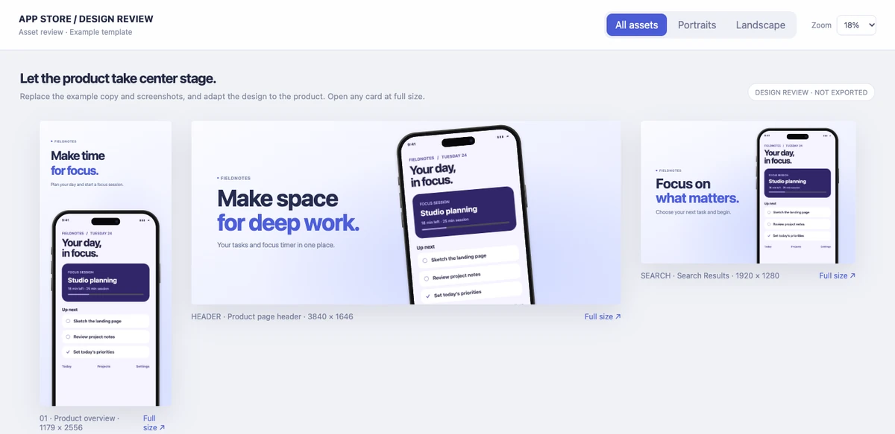
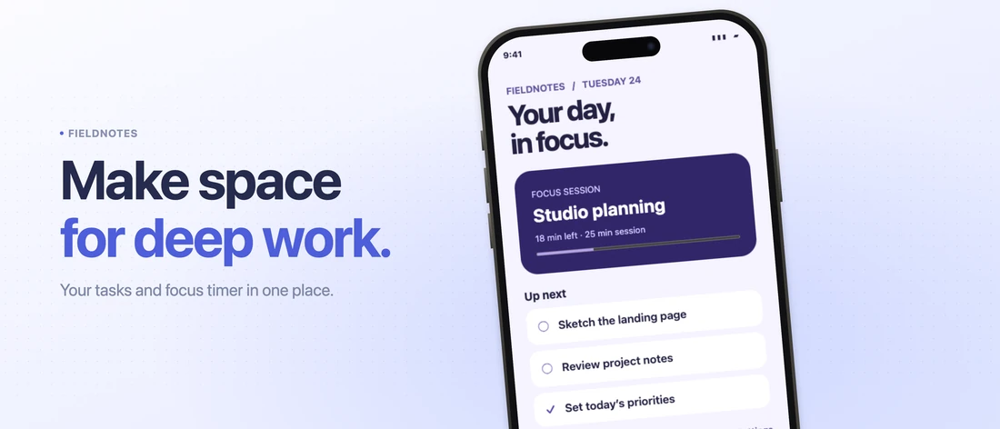
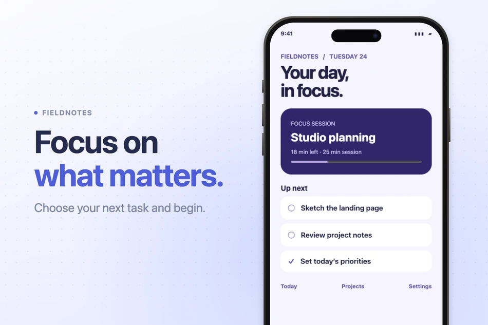

# 应用商店素材技能

[English](README.md)

根据真实 App 截图制作商店素材。选择目标商店的技能，先在本地 HTML 中评审设计，确认后再导出 PNG。

| 目标商店 | 技能 | 交付内容 |
| --- | --- | --- |
| Apple App Store | [codoop-app-store-assets](.agents/skills/codoop-app-store-assets/SKILL.md) | App Store 截图、产品页横幅和搜索结果图 |
| 小米应用商店 | [codoop-xiaomi-store-assets](.agents/skills/codoop-xiaomi-store-assets/SKILL.md) | 手机应用介绍截图和应用品牌展示图 |

## 小米应用商店素材

提供真实 Android 截图和应用图标。手机介绍截图按应用方向制作 1080 × 1920 竖图或 1920 × 1080 横图。应用品牌展示图使用独立的 1080 × 480 画布，是否提交以开发者后台为准。查看[小米素材规范](.agents/skills/codoop-xiaomi-store-assets/references/xiaomi.md)、[评审模板](.agents/skills/codoop-xiaomi-store-assets/assets/review.html)和 [Xiaomi 15 外壳预览](.agents/skills/codoop-xiaomi-store-assets/assets/xiaomi-frame.html)。

## 从 App 截图到 Apple App Store 素材

下面用虚构的专注计时 App **Fieldnotes** 展示设计流程和成品效果。

| 原始截图 | 竖版成品 |
| :---: | :---: |
|  |  |

提供 App 截图和可用的品牌素材后，技能会根据截图中呈现的功能规划每张图，并将 iPhone 截图等比放入[可复用的设备外壳](.agents/skills/codoop-app-store-assets/assets/iphone-frame.html)。

HTML 评审页支持总览、筛选、缩放和逐张查看原尺寸画布。你确认设计后，技能会从这些画布导出 PNG。



### 横版示例

产品页横幅（Header）和搜索结果图（Search Results）各可放 **1–3 张截图**。你可以指定每张图用哪些截图，也可以让技能根据版位和截图内容分别规划。下面两张示例各用一张截图，突出专注计时器。

**产品页横幅**



**搜索结果图**



以上图片为 README 缩放预览。导出前，技能会核对目标版位适用的 Apple 最新规格。

## 使用 Skills CLI 安装

在你的 App 项目中运行目标商店对应的命令。

```sh
# Apple App Store
npx skills add https://github.com/Codoop/codoop-app-pages --skill codoop-app-store-assets

# 小米应用商店
npx skills add https://github.com/Codoop/codoop-app-pages --skill codoop-xiaomi-store-assets
```

远程命令从 GitHub 上已发布的仓库版本安装。使用本地检出中的更新时，按下文从本地路径安装。CLI 会提示选择客户端，默认安装到当前项目。可用 `-a codex` 指定 Codex，或用 `-g` 安装到用户目录。可先运行 `npx skills add https://github.com/Codoop/codoop-app-pages --list` 查看可安装的技能。Node.js 版本要求、客户端支持和参数详见 [Skills CLI 文档](https://github.com/vercel-labs/skills)。

从本地检出目录安装时，运行 `npx skills add /path/to/codoop-app-pages --skill codoop-xiaomi-store-assets`。技能能否在 skills.sh 上搜索到取决于该服务的索引。

## 手动安装和使用

复制所选技能的**整个目录**，包括自带的模板、外壳样式和参考资料。下表是相对于你的 App 项目根目录的安装位置。

| 客户端 | 项目技能目录 | 调用方式 |
| --- | --- | --- |
| Codex | `.agents/skills/<skill-name>/` | 用 `$codoop-app-store-assets` / `$codoop-xiaomi-store-assets` 或按名称调用。 |
| Claude Code | `.claude/skills/<skill-name>/` | 按名称或通过技能命令调用。本仓库用符号链接指向技能目录，系统不支持符号链接时直接复制。 |
| Qwen Code | `.agents/skills/<skill-name>/` 或 `.qwen/skills/<skill-name>/` | 用 `/<skill-name>` 或按名称调用，可通过 `/skills` 查看。 |
| Google Antigravity App、CLI 或 IDE | `.agents/skills/<skill-name>/` | 按名称调用，App 和 CLI 也支持文档所述的斜杠调用方式。 |
| 通过 Codex 使用 DeepSeek | `.agents/skills/<skill-name>/` | 按宿主客户端的方式安装，其他 DeepSeek 客户端的路径可能不同。 |
| WorkBuddy | 见下方说明 | 开放平台发布需要额外的元数据字段。 |

在 macOS 或 Linux 上，手动为 Codex、Qwen Code 或 Antigravity 安装的示例：

```sh
mkdir -p /path/to/your-project/.agents/skills
cp -R /path/to/codoop-app-pages/.agents/skills/codoop-xiaomi-store-assets /path/to/your-project/.agents/skills/
```

用客户端打开 App 项目，必要时刷新或重启，然后查看可用技能。调用时提供真实 App 截图、品牌素材、目标设备、输出语言和设计偏好。若客户端无法自动发现技能，但能读取项目文件，可以直接请它读取复制后的 `SKILL.md` 和配套模板。

**WorkBuddy** 的开放平台技能包还需要名称、描述、版本和作者等字段。本仓库的技能包尚未完成该平台的打包和验证。本地导入和发布方式取决于所用版本。 [WorkBuddy 开放平台文档](https://open.workbuddy.cn/en/docs/skill)

安装路径参考各客户端文档，实际支持情况取决于客户端和版本。工作流程还需要访问项目文件、图像和最新规格，并能用浏览器或等效工具检查设计。 [Qwen Code](https://github.com/QwenLM/qwen-code/blob/main/docs/users/features/skills.md) · [Antigravity](https://prod-20251121t222213-dot-gweb-jetski.appspot.com/docs/skills?tab=ide) · [DeepSeek Codex 集成](https://api-docs.deepseek.com/quick_start/agent_integrations/codex/)

技能会结合项目品牌、界面和版位调整配色、文字和构图。HTML 模板里的文案和尺寸供演示使用，实际素材按目标 App 的版位资格、设备规格和裁切要求核对。导出前需要你确认设计，上传或发布需要另行明确授权。

## 许可证

本项目采用 [MIT 许可证](LICENSE)。
